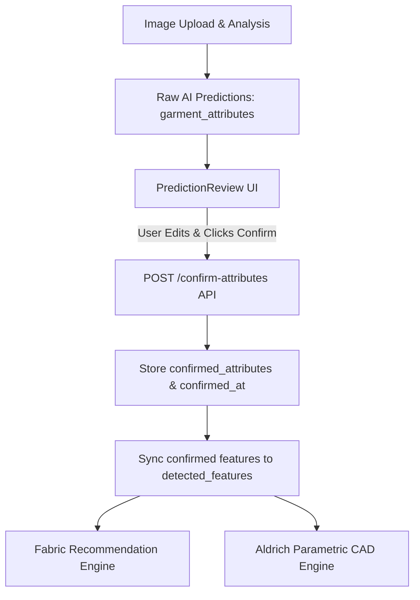

# Milestone M14 — Frontend AI Prediction Review, User Correction and Confirmation Flow Report

## Executive Summary

Milestone M14 delivers the complete user review, correction, and confirmation flow for AI-generated garment attribute predictions. Following image upload and multi-task analysis, the frontend presents predicted labels, confidence percentages, status badges, top-3 suggestions, and editable taxonomy controls for all four multi-task heads (`garment_type`, `neckline_type`, `sleeve_length`, `sleeve_style`). Downstream fabric recommendation and pattern generation are strictly gated behind explicit human confirmation.

---

## 1. Exact Changed and Created Files

| File Path | Action | Description |
|---|---|---|
| **`frontend/src/components/PredictionReview.jsx`** | `[NEW]` | Interactive prediction review component rendering 4 heads, confidence badges, top-3 suggestions, low-confidence warning alerts, editable dropdowns, and confirmation action button. |
| **`frontend/src/__tests__/PredictionReview.test.jsx`** | `[NEW]` | Frontend unit test suite covering prediction rendering, editing, confidence badges, low-confidence alerts, confirmation state, and active taxonomy validation. |
| **`frontend/src/pages/Upload.jsx`** | `[MODIFY]` | Integrated `PredictionReview` into Step 2, added confirmation handlers, gated fabric recommendation/pattern drafting behind explicit user confirmation, and passed confirmed attributes downstream. |
| **`frontend/src/services/api.js`** | `[MODIFY]` | Added `confirmAttributes: (id, data) => api.post('/images/<id>/confirm-attributes', data)` to `imagesAPI`. |
| **`backend/app/models/design_image.py`** | `[MODIFY]` | Added `confirmed_attributes = DictField(default=dict)` and `confirmed_at = DateTimeField(default=None)` schema fields. |
| **`backend/app/routes/images.py`** | `[MODIFY]` | Implemented `POST /api/images/<image_id>/confirm-attributes` endpoint enforcing 28-class taxonomy validation and persisting confirmed choices separately from raw AI model outputs. |
| **`backend/tests/test_multitask_integration.py`** | `[MODIFY]` | Added unit tests verifying `confirm-attributes` route, 28-class taxonomy validation, `cold-shoulder-sleeve` rejection, and raw output preservation. |
| **`frontend/M14_AI_PREDICTION_REVIEW.md`** | `[NEW]` | Final implementation and verification report for Milestone M14. |

---

## 2. UI Behavior & User Confirmation Flow

1. **Prediction Display**:
   - Renders 4 cards corresponding to the four classification heads: `Garment Type`, `Neckline Type`, `Sleeve Length`, `Sleeve Style`.
   - Displays AI predicted label, confidence percentage (e.g. `95.6%`), and status badge (`High` / `Low`).
   - Renders top-3 candidate suggestions under each control.
2. **Low-Confidence Warning**:
   - If any prediction head falls below its threshold, an amber alert banner displays: `"⚠️ Low Confidence Detected: Low prediction confidence on [head names]. Please review carefully and select the intended features."`
3. **Editable Selections**:
   - Dropdown controls are pre-populated with AI predictions but remain 100% editable even when confidence is high.
   - Dropdowns enforce the active 28-class taxonomy (3 garment types, 10 neckline types, 6 sleeve lengths, 9 sleeve styles). `cold-shoulder-sleeve` is completely omitted.
4. **Explicit Confirmation**:
   - Clicking **"Confirm Design Features"** sends the selected attributes to `POST /api/images/<id>/confirm-attributes`.
   - Once confirmed, a green success badge (`✓ Confirmed Design Features`) appears alongside an **"Edit & Re-confirm"** button.
   - Fabric recommendation and pattern drafting are blocked until confirmation is complete.
5. **Fallback Handling**:
   - If AI predictions are unavailable or image upload was skipped, a manual selection fallback interface renders with the exact same 28-class taxonomy.

---

## 3. Backend Confirmation API Contract

### Request
```http
POST /api/images/679812345abcdef/confirm-attributes HTTP/1.1
Authorization: Bearer <jwt_token>
Content-Type: application/json

{
  "garment_type": "crop-top",
  "neckline_type": "v-neck",
  "sleeve_length": "three-quarter-sleeve",
  "sleeve_style": "bell-sleeve"
}
```

### Response
```http
HTTP/1.1 200 OK
Content-Type: application/json

{
  "message": "Garment attributes confirmed successfully",
  "image_id": "679812345abcdef",
  "confirmed_attributes": {
    "garment_type": "crop-top",
    "neckline_type": "v-neck",
    "sleeve_length": "three-quarter-sleeve",
    "sleeve_style": "bell-sleeve"
  },
  "confirmed_at": "2026-09-28T10:30:00+00:00",
  "status": "confirmed"
}
```

---

## 4. Taxonomy Validation & Guardrails Audit

- **Enforced Active 28-Class Taxonomy**:
  - `garment_type`: `blouse`, `t-shirt`, `crop-top` (3)
  - `neckline_type`: `round-neck`, `v-neck`, `square-neck`, `scoop-neck`, `boat-neck`, `sweetheart-neck`, `halter-neck`, `high-neck`, `collared-neck`, `off-shoulder` (10)
  - `sleeve_length`: `sleeveless`, `cap-length`, `short-sleeve`, `elbow-length`, `three-quarter-sleeve`, `long-sleeve` (6)
  - `sleeve_style`: `none`, `regular-sleeve`, `puff-sleeve`, `bell-sleeve`, `bishop-sleeve`, `flutter-sleeve`, `raglan-sleeve`, `dolman-sleeve`, `kimono-sleeve` (9)
- **Removed Class Rejection**: Requests containing `cold-shoulder-sleeve` or unrecognised values return `400 Bad Request`.
- **Raw Prediction Preservation**: `garment_attributes` (raw model outputs) remain untouched in the database alongside `confirmed_attributes` for research evaluation.

---

## 5. Downstream Data Flow Proof



- Fabric recommendation and Aldrich 2D parametric pattern drafting consume confirmed attributes.
- Raw AI predictions remain isolated and accessible for research performance metrics.

---

## 6. Verification and Test Results

- **Frontend Vitest Unit Tests**: `18/18 PASSED`
- **Frontend Production Build (`npm run build`)**: **`PASSED`** (Vite build completed in 24.21s, dist bundle generated cleanly)
- **Backend Unit Tests**: `34/34 PASSED` (in 3.75s)
- **AI Training Unit Tests**: `PASSED`
- **Python Syntax Check (`py_compile`)**: `PASSED`
- **Git Diff & Whitespace Check (`git diff --check`)**: `PASSED`
- **Git Status**: Clean working tree ready for review. No commits, pushes, or merges performed.
